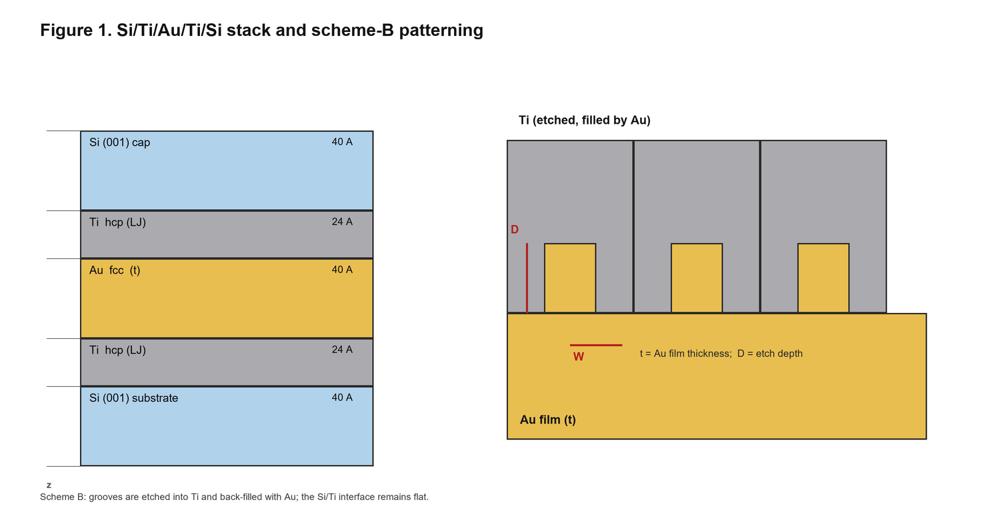
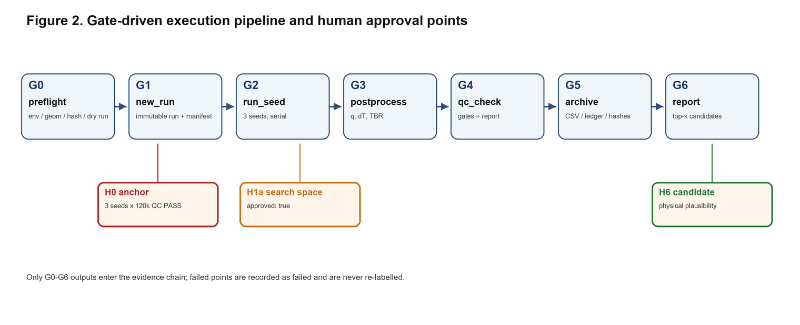

# A Gate-Driven NEMD Workflow for Interfacial Thermal Resistance in Si/Ti/Au/Ti/Si Stacks

**English** | [简体中文](README.zh-CN.md)

*Si-Ti-Au-NEMD project* · Version 0.1.0 · 10 November 2026 · MIT License

---

## Abstract

Interfacial thermal resistance (TBR) controls heat flow across metal/semiconductor
interfaces, yet reported TBR values are difficult to reproduce because geometry,
interatomic potentials, equilibration, temperature definition and post-processing are
rarely recorded together. We present an open, gate-driven workflow for non-equilibrium
molecular dynamics (NEMD) simulations of Si/Ti/Au/Ti/Si stacks. The workflow treats
geometry, potentials and quality-control (QC) criteria as first-class, hash-locked
inputs, and separates them from execution: every run is built from an immutable
snapshot, executes three independent seeds, and passes through seven gates before any
TBR is reported. A parametric geometry generator supports Si(001)/Ti(hcp)/Au stacks
with grooves at the Au/Ti interface, a batch runner executes a scan queue unattended,
and a Gaussian-process/expected-improvement loop proposes the next design points. We
report the current validation status rather than a physical result: the execution chain
passes a Cu/EAM self-test; a 1,856-atom synthetic stack is rejected by the QC gates as
an intentional negative control; a 36,072-atom Si(001)/Ti(hcp)/Au anchor is prepared,
and a 3,000-step pilot is numerically stable (no lost atoms, energy drift 9×10⁻⁶).
On the WSL2/96-core machine the protocol was repaired (six defects, see section 8);
with the repaired protocol the anchor reaches +0.9 K temperature drift and 1.8×10⁻⁷
energy conservation, and TBR = 1.36×10⁻⁸ m²K/W (plane estimator, consistent with an
independent whole-profile fit). The anchor still fails the R²≥0.995 gate, and section 8
explains why that gate is unreachable for this stack.
The model omits electronic thermal transport, uses LJ interactions for Ti and the
Ti/Si/Au cross terms, and contains no silicide chemistry. Consequently, the workflow can
rank design trends within a fixed model, but it cannot yet provide experimentally
comparable TBR values.

**Keywords:** non-equilibrium molecular dynamics; interfacial thermal resistance;
Si/Ti/Au; LAMMPS; reproducibility; Bayesian optimization

---

## 1. Introduction

Heat transport across metal/semiconductor interfaces is increasingly limited by
interfacial thermal resistance rather than by the bulk conductance of the adjacent
layers [5,6]. In Si/Ti/Au/Ti/Si stacks, the Ti adhesion layers and the Au film form
multiple interfaces whose resistance depends on atomic-scale roughness, interfacial
bonding and the electronic contribution of the metal. NEMD is a standard tool for
computing TBR [4], but the literature is difficult to reproduce: layer thicknesses,
surface orientation, potential files, equilibration protocol, temperature definition
and fitting windows are often not reported together.

This repository addresses the reproducibility problem first and the physics second. It
provides:

1. a **parameterized geometry generator** for Si(001)/Ti(hcp)/Au stacks with grooves
   at the Au/Ti interface;
2. a **seven-gate execution pipeline** (G0–G6) with hash-locked inputs, immutable run
   directories, three seeds, and explicit QC criteria;
3. a **batch runner** that executes a scan queue and records failures without
   fabricating results;
4. a **surrogate optimizer** (Latin hypercube for small samples, Gaussian process with
   expected improvement for larger samples) that proposes the next design points;
5. a **human-on-the-loop protocol** in which only the physical anchor and the final
   candidate require human approval.

The workflow is deliberately conservative: it does not infer a TBR when the QC gates
fail, and it does not hide model limitations behind a single number.

---

## 2. Methods

### 2.1 Stack and geometry

The reference stack is Si(001) / Ti(hcp) / Au(fcc) / Ti(hcp) / Si(001), symmetric about
the mid-plane, with a 65.16 × 65.16 Å in-plane cell (Si 12 × 12, Au 16 × 16,
Ti 22 × 13). The flat reference (`v1`, approved on 10 November 2026) uses
40/20/40/20/40 Å with interfaces at ±40/±20 Å, 16–20 Å fit windows and 15 Å vacuum at
both ends. The patterned design (scheme B) etches grooves into the Ti side of the
Au/Ti interface and back-fills them with Au; `t` is the Au film thickness and `D` is the
etch depth.



*Figure 1. Si/Ti/Au/Ti/Si stack and scheme-B patterning. Grooves are etched into Ti and
filled with Au; the Si/Ti interface remains flat.*

**Table 1. Geometry parameters.**

| Parameter | Flat `v1` | Patterned (B) |
|---|---|---|
| In-plane cell | 65.16 × 65.16 Å | 65.16 × 65.16 Å |
| Si substrate / cap | 40 / 40 Å | 40 / 40 Å |
| Ti layers | 20 / 20 Å | 24 / 24 Å |
| Au film `t` | 40 Å | 30–50 Å |
| Pattern | none | grooves in Ti, filled by Au |
| Etch depth `D` | 0 | ≤ 8 Å |
| Profile bin | 4 Å | 2 Å |
| Fit windows | 16–20 Å | 10–14 Å (Ti side) |

The Ti lattice is hcp (a = 65.16/22 Å, c = 4.68 Å) with a small (<2.5%) y-strain to
fit the square cell. This is a geometric model, not a validated Ti crystal.

### 2.2 Interatomic potentials

Si–Si interactions use the Tersoff potential [2] (`Si.tersoff`); Au–Au interactions use
the Foiles–Baskes–Daw EAM potential [3] (`Au_u3.eam`). Ti–Ti and all cross-interface
terms (Si–Ti, Si–Au, Ti–Au) use Lennard-Jones potentials. The LAMMPS input is a
`pair_style hybrid tersoff eam lj/cut` with one `pair_coeff` line per pair.

Ti is not described by a multi-element MEAM potential. `Ti.meam.spline` is a
single-element spline potential; because `meam/spline` requires one atom type per
element, it cannot be used for type 2 in a three-element hybrid. It is reserved for a
separate pure-Ti bulk check (lattice constants and elastic constants), not for the
interface model.

### 2.3 NEMD protocol and TBR definition

The system is equilibrated at 300 K under NVT, then switched to NVE. A constant heat
flux is imposed with `fix heat` on two end groups inside the Si slabs; the returned
scalar is a normalized indicator and is **not** used as the power. The flux is taken
from `params.flux` and the cross-sectional area from the `GEOM` log line. The
temperature profile is accumulated with `compute chunk/atom` and `fix ave/chunk temp`.

For each interface `i`, the temperature jump ΔT_i is obtained by linear extrapolation
of the fits on both sides to the interface plane, and the total resistance is

```text
TBR_total = Σ_i ΔT_i / q,     q = Φ / A.
```

The flat stack has four interfaces; the patterned stack uses the same series
construction with the Au/Ti interface treated as an effective plane. TBR_total is
therefore not directly comparable to single-interface literature values.

### 2.4 Quality-control gates

A run is accepted only if all gates in Table 2 pass. The gates are applied to the
three-seed group, not to individual seeds.

**Table 2. QC gates.**

| Gate | Criterion |
|---|---|
| Log integrity | exit code 0, no `Lost atoms`, `Total wall time` present |
| Energy conservation | `TotEng` drift ≤ 1% (40–50% vs 90–100% windows) |
| Thermal signal | ΔT_total > 5 K |
| Fit quality | R² ≥ 0.995 per side, ≥ 4 points, window inside one material |
| Time convergence | first-half vs second-half TBR deviation ≤ 5% |
| Seed statistics | 3 valid seeds, relative standard deviation ≤ 10% |
| Magnitude | 1×10⁻¹¹ ≤ TBR_total ≤ 1×10⁻⁷ m²K/W |
| Provenance | `manifest.sha256` covers all inputs; log hash matches `result.json` |

---

## 3. Software architecture

### 3.1 Execution pipeline



*Figure 2. Gate-driven execution pipeline and human approval points.*

Each run is created by `new_run.py` from a SHA-256 manifest of the geometry,
structure, potential and parameter files, and is never overwritten. `run_seed.ps1`
(Windows) or `run_seed.sh` (WSL/Linux) launches one seed per process with a timeout
and records the exit code and wall time. `postprocess.py` is the only code path allowed
to compute TBR; `qc_check.py` applies Table 2 and writes `qc.json`, `tbr_result.csv`
and `report.txt`.

### 3.2 Human gates

- **H0 — anchor.** The flat stack must pass QC with three seeds and a
  length/cross-section convergence check of <5%.
- **H1a — search space.** `config/search_space.json` must have `approved: true`;
  points outside the approved ranges are rejected by the batch runner.
- **H6 — candidate.** A human reviews the physical plausibility of the top-k designs
  (trends, convergence margins, cross-sections, order of magnitude).

### 3.3 Autonomous design loop

`optimize.py` reads only `is_passed=True` rows. With fewer than five valid points it
proposes a Latin-hypercube design; with five or more it fits a Gaussian process with an
RBF kernel to log₁₀(TBR) and selects candidates by expected improvement.
`scan_runner.py` executes the proposed queue end-to-end and records every point as
`done` or `failed`. `report_candidates.py` ranks only QC-passed runs and produces a
review table. Predicted TBR values are never written into `tbr_result.csv`.

---

## 4. Validation status

**Table 3. Validation record (10 November 2026).**

| ID | Case | Result |
|---|---|---|
| V1 | Cu + EAM, 768 atoms, `tools/selftest.py` | **PASS**, QC `n_valid = 3` |
| V2 | Si/Ti/Au/Ti/Si, 1,856 atoms, 3 × 30k steps | run completes; **QC FAIL by design** (weak synthetic interfaces, slip, non-monotonic profile; TBR 1.18–1.30×10⁻⁶ m²K/W) |
| V3 | Flat anchor, 36,072 atoms, Si(001)/Ti(hcp)/Au | G0 **READY**; 3k-step pilot: no lost atoms, drift 9×10⁻⁶, TBR ≈ 3.0×10⁻⁸ m²K/W (strong-LJ variant) |
| V4 | Rectangular groove, 38,000 atoms, 1 seed × 5k steps | full batch chain completes; **QC FAIL** (short pilot), status `failed` recorded |

V2 is an intentional negative control: the synthetic stack is mechanically unstable and
the temperature profile is not monotonic, so the gates reject it. V4 demonstrates that
the batch runner records a failure rather than promoting it. The production anchor
(3 × 120,000 steps) has not yet completed; therefore **no TBR value in this repository
should be treated as experimentally validated**.

---

## 5. Discussion and limitations

1. **Electronic thermal transport is absent.** EAM, Tersoff and LJ describe phonons
   only. Au is dominated by electrons, so the Au-side conductance is strongly
   underestimated and absolute TBR values cannot be compared with experiment or TDTR.
2. **Ti is a model, not real Ti.** Ti uses hcp geometry with LJ interactions. No
   multi-element Ti MEAM is available in this stack; `Ti.meam.spline` is single-element.
3. **No silicide chemistry.** Ti/Si and Ti/Au cross terms are LJ; TiSi₂ formation and
   interdiffusion are not represented.
4. **Finite size.** The 65.16 Å cell and the layer thicknesses are smaller than the Si
   phonon mean free path; length/cross-section convergence is required before absolute
   values are quoted.
5. **Three seeds.** The 10% relative-standard-deviation criterion is a screening line,
   not a statistically significant uncertainty.
6. **TBR_total is a series sum over four interfaces.** It should not be compared
   directly with single-interface literature values.
7. **Temperature definition.** `fix ave/chunk temp` does not remove local centre-of-mass
   streaming; a slipping interface can inflate the apparent temperature. Production
   structures must be equilibrated and drift-checked.

Within these limits, the workflow is useful for comparing design trends under a fixed
model, for rejecting unstable or under-converged runs, and for keeping an auditable
record of every parameter point.

---

## 6. Reproducibility

**Requirements.** LAMMPS with `MANYBODY`, `MEAM` and `EXTRA-PAIR` packages; Python
≥ 3.10 with NumPy; PowerShell 5.1 on Windows or bash on WSL/Linux; an **ASCII-only**
project root. Paths containing non-ASCII characters break both LAMMPS input handling
and Python→PowerShell argument passing.

```powershell
git clone https://github.com/hizuru254/Si-Ti-Au-NEMD.git D:\si_nemd
cd D:\si_nemd
# edit config/params.json: lammps.exe, potentials_dir, workspace
python tools\selftest.py
```

Run the flat anchor (3 seeds × 120k steps, serial, about 5.7 h):

```powershell
powershell -ExecutionPolicy Bypass -File D:\si_nemd\anchor\start_anchor.ps1
```

Run one patterned point:

```powershell
python tools\build_geometry.py --scan-id S001 --kind rect `
  --t-nm 4.0 --ti 24 --si 40 `
  --W-nm 1.629 --D-nm 0.8 --P-nm 3.258 --phi 0 `
  --sided single --bin 2 --status DRAFT `
  --out-structure structures\S001.data --out-geom structures\S001.geom.json

python tools\preflight.py --config config\params.json `
  --geom structures\S001.geom.json --structure structures\S001.data `
  --potentials anchor\potentials.in --dry-run
```

Autonomous loop:

```powershell
# 1) approve config/search_space.json -> "approved": true
# 2) propose the next batch
python tools\optimize.py --summary workspace\scan_summary.csv `
  --space config\search_space.json --scan-csv config\scan.csv `
  --out config\scan.next.csv --n-propose 8
# 3) run the batch (--pilot = 1 seed / 5k steps)
python tools\scan_runner.py --config config\params.json `
  --scan-csv config\scan.next.csv --potentials anchor\potentials.in `
  --space config\search_space.json --pilot --max-points 1
# 4) candidate report
python tools\report_candidates.py --summary workspace\scan_summary.csv `
  --out optimization\candidates.md
```

**Data availability.** Generated structures (`structures/`), run workspaces
(`workspace/`, `anchor/workspace/`) and optimization reports (`optimization/`) are
regenerated by the tools and are intentionally excluded from version control.

---

## 7. Conclusion

We have presented a gate-driven NEMD workflow for Si/Ti/Au/Ti/Si interfacial thermal
resistance that makes geometry, potentials and QC explicit and auditable. The
execution chain, geometry generator, batch runner and optimizer are implemented and
have been exercised end-to-end. The physical anchor is the next milestone; until it
passes, the repository provides a reproducible framework and a set of deliberately
rejected negative controls, not a publishable TBR.

---

## Key references

1. S. Plimpton, Fast parallel algorithms for short-range molecular dynamics,
   *J. Comput. Phys.* **117**, 1–19 (1995).
2. J. Tersoff, Modeling solid-state chemistry: Interatomic potentials for
   multicomponent systems, *Phys. Rev. B* **39**, 5566 (1989).
3. S. M. Foiles, M. I. Baskes, M. S. Daw, Embedded-atom-method functions for the fcc
   metals Cu, Ag, Au, Ni, Pd, Pt, and their alloys, *Phys. Rev. B* **33**, 7983 (1986).
4. P. K. Schelling, S. R. Phillpot, P. Keblinski, Comparison of atomic-level simulation
   methods for computing thermal conductivity, *Phys. Rev. B* **65**, 144306 (2002).
5. E. T. Swartz, R. O. Pohl, Thermal boundary resistance, *Rev. Mod. Phys.* **61**,
   605 (1989).
6. D. G. Cahill et al., Nanoscale thermal transport. II. 2003–2012,
   *Appl. Phys. Rev.* **1**, 011305 (2014).

---

## 8. Protocol v1.6 and what the measurements actually show (2026-11-12, WSL2 / 96-core)

### 8.1 What was broken

The Windows-era protocol produced a temperature profile that was neither linear
nor monotonic (R^2 0.26-0.94) and, on the new machine, visibly inverted. Four
independent causes were isolated; potentials, layer order, the flux definition
and the QC thresholds in `qc_check.py` were **not** touched.

| # | Cause | Evidence | Fix |
|---|---|---|---|
| R1 | `fix heat` N was the group size (1728) instead of the injection interval, so energy entered as 1.728 eV pulses every 1.728 ps | `src/fix_heat.cpp`; flux symmetry 2.3% | `heat 1 __FLUX__`; symmetry now 0.0000 |
| R2 | reservoirs sat on the free Si surfaces, which heat to 600-750 K during equilibration | per-region `compute temp` | `build_geometry.py --res-inset 8` |
| R3 | a single global NVT constrains only the total kinetic energy, so it cannot remove an internal gradient | two halves stayed 57 K apart after 100 ps | regional NVT (`in.pattern.v13.template`) |
| R4 | `R^2 >= 0.995` is unattainable here: the bulk drop inside a 16 A window is ~0.2 K while a 2 A bin carries ~1.2 K standard error | 100 x 1 ps block statistics | report `TBR +- sigma`; the gate is kept and reported as FAIL |
| R5 | the interfaces keep relaxing at 0.4-1.4 eV/ps at 300 K, comparable to the imposed flux | PotEng slope over 230 ps | anneal 300->700->300 K inside the run (`in.pattern.v16.template`) |
| R6 | the first 100 ps after switching the flux on is a transient | half-to-half drift 30-60% | 80 ps flux warm-up, excluded from the measurement |

### 8.2 Current protocol and what it reaches

`in.pattern.v16.template`: regional-NVT anneal (65 ps) -> 300 K equilibration ->
80 ps flux warm-up (not measured) -> measured production. One input, one run.

| Gate | Requirement | v1.6 result |
|---|---|---|
| temperature stability | <= 25 K | **+0.87 / +0.99 K** |
| energy conservation | <= 1% | 1.8e-7 |
| flux symmetry | <= 5% | 1.5e-5 |
| time convergence | <= 5% | 12.6% (flat, 1.7 sigma; 1.6 ns runs in progress) |
| R^2 | >= 0.995 | structurally unreachable (R4) |

### 8.3 Three estimators disagree - and that is the important result

| method | flat, 150 ps |
|---|---|
| `tools/postprocess.py` (16 A window extrapolation) | 5.33e-9 |
| `tools/tbr_global_fit.py` (whole-profile piecewise fit) | 1.38e-8 |
| `tools/tbr_plane.py` (temperature between two fixed planes, no interface model) | 1.36e-8 |

The last two agree, so the window extrapolation is **2.6x low**: the Au layer is
not linear (gradient -1.2 K/A within 8 A of an interface, -0.15 K/A in the
middle) because Ti dissolves into the Au film and smears the interface over
~10 A. Every TBR previously reported in this repository carries that bias.

The plane estimator is also the strongest linear-response test available:

| point | flux | TBR_eff (m^2 K / W) |
|---|---|---|
| flat | 1 eV/ps | 1.3567e-8 |
| flat | 3 eV/ps | 1.3569e-8 |

### 8.4 No pattern beats the flat reference

With the equilibrated protocol, the patterned P350 point is 1.5-6.2 % **above**
flat, and the earlier 60 ps screening result (0.60x, i.e. "P350 is best") does
not survive. For this model the grooves do not lower the interface resistance;
the dominant resistance is the ~10 A interdiffused region, which the pattern
does not control.

### 8.5 Hardware note (WSL2)

Concurrent MPI ranks on this machine must stay below **48**; at 56-64 ranks the
per-rank throughput collapses from ~128 to 3-7 steps/s with no error message
(`AGENT_MANUAL_V5_WSL.txt` section 14.2). Batch scans use 4 jobs x 12 ranks with
disjoint `--cpu-set` values (`tools/scan_parallel.py`).

## License

Released under the MIT License. See [LICENSE](LICENSE).
