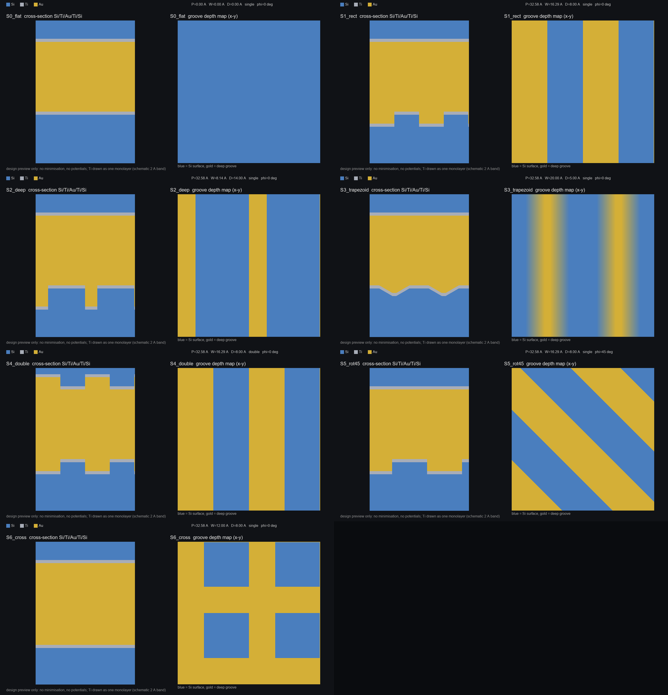

# Si/Ti/Au/Ti/Si NEMD Agent Workflow

一套给本地 LLM Agent 使用的 LAMMPS NEMD 执行与取证框架：把“算一个界面热阻”拆成
可校验、可复现、可追责的固定流程，避免 Agent 自行改物理、伪造数据或跳过门禁。

仓库：<https://github.com/hizuru254/Si-Ti-Au-NEMD>（私有）

> **层序（唯一正确顺序，从下到上）**
>
> `Si 衬底 / Ti 粘附层 / Au 中间层 / Ti 粘附层 / Si 顶盖`
>
> 本文档和所有示例均以 `Si/Ti/Au/Ti/Si` 为准。旧版 `Au/Ti/Si/Ti/Au` 是错误层序，已废弃。

> **定位**：本仓库是“执行框架 + 工具链”，不是物理结论。仓库内的验证算例是合成结构，
> 只用于证明流程可执行；真实 TBR 必须用人类批准的几何、势函数和已平衡结构重算。

## 状态

| 项目 | 结果 |
|---|---|
| 几何 v1 | **APPROVED**（2026-11-10）：40/20/40/20/40 Å，界面 ±40/±20 |
| 势函数方案 | Ti-Ti 与跨界面用 **LJ**；Si-Si 用 Tersoff；Au-Au 用 EAM |
| 并行方式 | **串行**（MS-MPI 在本机报 `error 5`，命名管道 / smpd 服务不可用；3.7 万原子约 6.6 h/组） |
| 操作系统 | Windows 11（PowerShell 5.1，无 pwsh 7） |
| LAMMPS | `D:\LAMMPS\LAMMPS 64-bit 4Jul2026-MSMPI\bin\lmp.exe`（4 Jul 2026） |
| 势函数 | `D:\LAMMPS\Tersoff\` 下的 `Si.tersoff`、`Ti.meam.spline`、`Au_u3.eam` |
| 工具链演练 | `tools/selftest.py` **PASS**（Cu 768 原子，QC `n_valid=3`） |
| 锚点结构 | 平面 v1：36,072 原子，Si(001)/Ti(hcp)/Au/Ti/Si，G0 **READY** |
| 锚点试运行 | 3k 步稳定（无 Lost atoms，drift 9e-6，TBR 3.0e-8）；正式 3×120k 待启动（约 5.7 h） |
| 自动搜索框架 | `scan_runner` / `optimize` / `report_candidates` 已实现，1 点 pilot 端到端跑通 |
| 三元素验证 | `Si/Ti/Au/Ti/Si` 1856 原子，3 seed × 30000 步，全部 exit 0；QC 按预期 FAIL |
| 形状预览 | 7 个 `Si/Ti/Au/Ti/Si` 初始结构，约 21k 原子，见 `shapes/` |

## 快速开始

```powershell
# 1. 克隆到纯 ASCII 路径（不要放在含中文的目录下）
git clone https://github.com/hizuru254/Si-Ti-Au-NEMD.git D:\si_nemd
cd D:\si_nemd

# 2. 按本机路径修改 config\params.json：
#    lammps.exe / lammps.mpiexec / potentials_dir

# 3. 工具链演练（不消耗真实机时）
$PY = "C:\Users\<you>\...\python.exe"
& $PY .\tools\selftest.py

# 4. 验证工程的前置校验
& $PY .\tools\preflight.py --config .\validation\params.json `
    --geom .\validation\geom.json --structure .\validation\structure.data `
    --potentials .\validation\potentials.in --dry-run
```

自检最后一行应为：

```text
[SELFTEST] PASS: 工具链可执行（物理判据未验证）
```

## 仓库结构

```text
.
├─ AGENT_MANUAL_V5_WIN.txt      # 本机（Windows 原生）已验证手册
├─ AGENT_MANUAL_V5_WSL.txt      # 另一台 WSL2 机器手册（未验证，附差异表）
├─ AGENT_MANUAL_V4.txt          # 已废弃：层序错误的旧版，仅作历史说明
├─ config/
│  ├─ params.json               # 全局参数与阈值（单一事实源）
│  ├─ scan.example.csv          # 扫描队列模板（kind 列）
│  ├─ search_space.example.json # 搜索空间/批准开关
│  └─ potentials.lock.example.json
├─ templates/in.pattern.template
├─ tools/
│  ├─ build_geometry.py         # 生产几何：Si(001)/Ti(hcp)/Au, B 方案
│  ├─ geomlib.py                # 几何/数据文件校验
│  ├─ preflight.py              # Gate 0：环境与输入契约
│  ├─ new_run.py                # 建版（原子、不可覆盖）
│  ├─ scan_runner.py            # 批量：scan -> build -> G0 -> run -> qc
│  ├─ optimize.py               # GP/EI（或 LHS）提议下一批点
│  ├─ report_candidates.py      # top-k 候选报告
│  ├─ scan_status.py            # 只改 scan.csv 的 status 列
│  ├─ run_seed.ps1              # 单 seed 启动器（Windows）
│  ├─ run_seed.sh               # 单 seed 启动器（WSL，未验证）
│  ├─ postprocess.py            # 唯一允许的后处理
│  ├─ qc_check.py               # 全部门禁 + CSV + 报告
│  ├─ selftest.py               # 端到端演练（Cu）
│  ├─ build_stack_validation.py # 三元素验证结构（非生产）
│  └─ build_shapes.py           # 形状预览生成器
├─ docs/
│  └─ AUTONOMOUS_LOOP.md        # 自主设计循环（路线图与验收标准）
├─ examples/
│  ├─ geom.SiTiAu.v1.json       # 已确认几何（APPROVED，2026-11-10）
│  └─ geom.SiTiAu.legacy.json   # 旧几何反例
├─ validation/                  # 三元素验证工程（含一次完整运行的证据）
├─ anchor/                      # 锚点工程：平面 v1 + 强 LJ 界面，3 seed × 120k
├─ structures/                  # build_geometry.py 生成的结构（gitignore）
└─ shapes/                      # 7 个形状的 data / PNG / zip
```

## 文档

- [AGENT_MANUAL_V5_WIN.txt](AGENT_MANUAL_V5_WIN.txt)：本机执行手册。包含环境事实、G0–G6 门禁、S0–S9 流程、判据、异常分类、HITL、已实测的势函数接线。
- [AGENT_MANUAL_V5_WSL.txt](AGENT_MANUAL_V5_WSL.txt)：另一台 WSL2 + LAMMPS 29Sep2021 + 96 核机器的差异版。所有未验证命令都标了 `[未验证]`，并附首次上机检查清单。
- [AGENT_MANUAL_V4.txt](AGENT_MANUAL_V4.txt)：**已废弃**。它把层序写成 `Au/Ti/Si/Ti/Au`，不要使用。

## 形状预览

7 个 `Si/Ti/Au/Ti/Si` 初始形状：平面基准、矩形槽、深窄槽、60° 梯形槽、双面槽、45° 斜槽、交叉槽。
每个结构都有 LAMMPS data 文件、截面图和深度图；Ti 在预览中用单层近似表示。



参数、原子数和 OVITO 打开方式见 [shapes/README_shapes.txt](shapes/README_shapes.txt)。
压缩包：[shapes/SiAu_shapes.zip](shapes/SiAu_shapes.zip)。

## 判据摘要

| 门禁 | 判据 |
|---|---|
| 日志完整 | 退出码 0、无 `Lost atoms`、有 `Total wall time` |
| 能量守恒 | `TotEng` 漂移 ≤ 1%（40–50% vs 90–100% 双窗） |
| 温度信号 | `dT_total > 5 K` |
| 拟合质量 | 每侧 R² ≥ 0.995、≥ 4 点、窗口在单一材料内 |
| 时间收敛 | 前后半段 TBR 偏差 ≤ 5% |
| 种子统计 | 3 个种子全部有效、相对标准差 ≤ 10% |
| 量级检查 | `1e-11 ≤ TBR_total ≤ 1e-7 m²·K/W` |
| 数据溯源 | `manifest.sha256` 覆盖全部输入，日志哈希与 `result.json` 一致 |

`TBR_total = ΣΔT_i / q` 是四个界面的串联总阻；与单界面文献比较时不能直接对等。

## 自主设计循环（路线图）

目标：人类只做两次判断，其余由 AI 完成。

1. **H0 锚点**（人类一次）：平面 v1 的 3 seed 全部 QC PASS，且长度/截面收敛 <5%。
2. **AI 自主循环**：设计形状 → 小细胞筛选 → 代理模型（GP/EI）→ 完整细胞精算 → 排名。
3. **H6 候选**（人类一次）：审核 top-5 的物理合理性（趋势、收敛、截面图、量级）。

完整设计、成本模型、审核清单和验收标准见
[docs/AUTONOMOUS_LOOP.md](docs/AUTONOMOUS_LOOP.md)。

当前状态：G0–G4、形状预览已可用；`build_geometry.py` 已实现，平面锚点
（36,072 原子）与矩形槽（38,000 原子）均通过 G0。锚点 3×120k 需要约 5.7 h，
请在独立 PowerShell 窗口启动：

```powershell
powershell -ExecutionPolicy Bypass -File D:\si_nemd\anchor\start_anchor.ps1
```

日志：`anchor\workspace\anchor_run.log`；结果：`anchor\workspace\run_vNNN\report.txt`。

## 自动搜索（代码已就绪，待锚点与空间批准）

```powershell
# 1) 批准搜索空间：把 config/search_space.json 的 approved 改为 true
# 2) 提议下一批点（<5 个有效点用 LHS，>=5 用 GP+EI）
python tools/optimize.py --summary workspace/scan_summary.csv `
  --space config/search_space.json --scan-csv config/scan.csv `
  --out config/scan.next.csv --n-propose 8

# 3) 批量跑（--pilot 为 1 seed/5k 步；正式去掉 --pilot）
python tools/scan_runner.py --config config/params.json `
  --scan-csv config/scan.next.csv --potentials config/potentials.in `
  --space config/search_space.json --pilot --max-points 1

# 4) 生成候选报告
python tools/report_candidates.py --summary workspace/scan_summary.csv `
  --out optimization/candidates.md
```

- `scan_runner` 自动完成：生成结构 → G0 → 建版 → 跑种子 → 后处理 → QC → 更新
  `scan.csv` 状态与 `workspace/scan_summary.csv`；失败点记 `failed`，不重试、不改阈值。
- 未批准的空间（`approved=false`）或越界点会被拒绝；只有 `--allow-draft` 才放行 DRAFT。
- **运行根必须纯 ASCII**：`C:\Users\绯鹤\...` 会让 Python→PowerShell 的参数乱码
  （已实测 `run_seed.ps1` 找不到中文路径），请用 `D:\si_nemd`。

## 已知限制

这些是模型层面的限制，不能靠改文档消除：

1. **电子热导缺失**：EAM/Tersoff/LJ 只描述声子。Au 的电子热导占主导，模型严重低估 Au 侧热导，TBR 绝对值不能直接对实验/TDTR。
2. **界面化学缺失**：真实 Ti/Si 会形成硅化物，当前 Ti-Si、Ti-Au 交叉项是 LJ。
3. **Ti 势函数**：本机没有 Ti 的多元素 MEAM；验证结构用 fcc-Ti + LJ。生产需人类定稿。
4. **有限尺寸**：65.16 Å 面内、几十 nm 厚度小于 Si 声子平均自由程，需补长度/截面收敛。
5. **温度定义**：`fix ave/chunk` 的 `temp` 不扣除局域质心速度；有整体滑移时会高估温度，需先确认结构无漂移。
6. **样本量**：n=3 的标准差只是筛查线，不是统计保证。

更多细节见 `AGENT_MANUAL_V5_WIN.txt` 附录 D。

## 验证记录

`validation/workspace/run_v001` 是一次完整运行（3 seed × 30000 步）：

- 三个 seed 全部退出码 0、无 `Lost atoms`，约 97 s/seed（串行）；
- ΔT_total 357–393 K，TBR_total 1.18–1.30×10⁻⁶ m²·K/W；
- QC **FAIL**（R² 0.00–0.70、前后半段差 16–25%），原因是合成叠层的弱界面导致 Au 中间层滑移，不是工具链故障。

## 许可

仓库暂未指定开源协议。如需公开复用，请补充 `LICENSE`（例如 MIT 或 CC-BY-4.0）。
