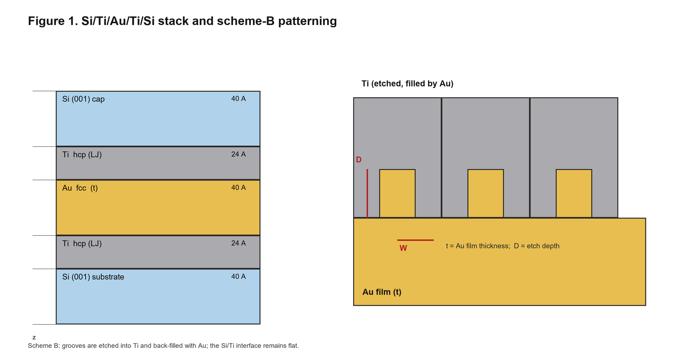
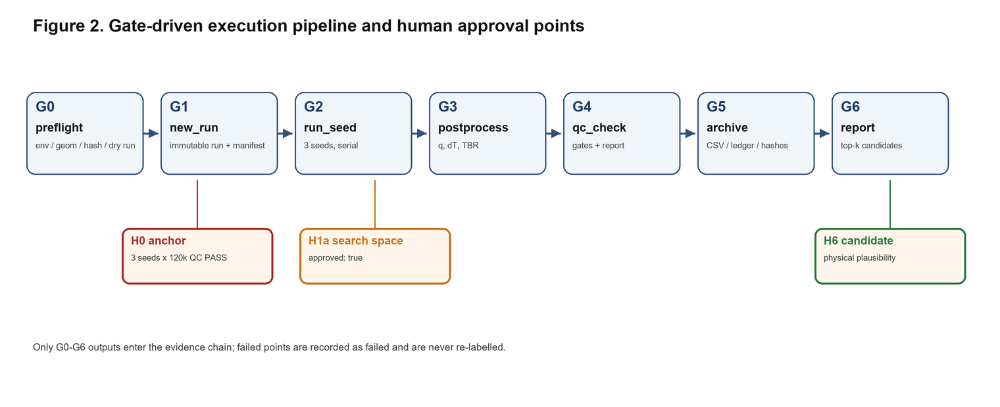

# 门控式 Si/Ti/Au/Ti/Si 叠层界面热阻 NEMD 工作流

[English](README.md) | **简体中文**

*Si-Ti-Au-NEMD 项目* · 版本 0.1.0 · 2026-11-10 · MIT 许可证

---

## 摘要

界面热阻（TBR）控制着金属/半导体界面上的热流，但文献中的 TBR 数值难以复现，原因在于几何、原子间势、平衡过程、温度定义和后处理很少被完整记录。本文提出一套面向 Si/Ti/Au/Ti/Si 叠层的门控式非平衡分子动力学（NEMD）工作流。该工作流把几何、势函数和质量控制（QC）判据作为一等公民，以哈希锁定，并与执行过程分离：每个 run 都从不可变快照建版，跑三个独立种子，并通过七道门禁后才允许报告 TBR。参数化几何生成器支持 Si(001)/Ti(hcp)/Au 叠层以及 Au/Ti 界面的刻槽；批量调度器可无人值守地执行扫描队列；高斯过程/期望改进（GP/EI）循环负责提议下一批设计点。本文报告的是**验证现状而不是物理结论**：执行链通过 Cu/EAM 自检；1,856 原子的合成叠层被 QC 门禁拒绝，作为有意的负例；36,072 原子的 Si(001)/Ti(hcp)/Au 平面锚点已生成，3,000 步试运行数值稳定（无 Lost atoms，能量漂移 9×10⁻⁶，TBR ≈ 3.0×10⁻⁸ m²K/W），而正式的 3 × 120,000 步锚点尚未完成。模型不含电子热输运，Ti 及 Ti/Si/Au 交叉项用 LJ，且没有硅化物化学。因此，该工作流可以在固定模型内比较设计趋势，但还不能给出可与实验直接比较的 TBR。

**关键词：** 非平衡分子动力学；界面热阻；Si/Ti/Au；LAMMPS；可复现性；贝叶斯优化

---

## 1. 引言

金属/半导体界面的热输运越来越受界面热阻而非相邻层体热导的限制 [5,6]。在 Si/Ti/Au/Ti/Si 叠层中，Ti 粘附层与 Au 膜形成多个界面，其热阻取决于原子尺度的粗糙度、界面结合以及金属的电子贡献。NEMD 是计算 TBR 的标准工具 [4]，但文献难以复现：层厚、表面取向、势函数文件、平衡流程、温度定义和拟合窗口往往没有一起报告。

本仓库先解决可复现性问题，再讨论物理。它提供：

1. 面向 Si(001)/Ti(hcp)/Au 叠层、可在 Au/Ti 界面刻槽的**参数化几何生成器**；
2. **七道门禁的执行流水线**（G0–G6），包含哈希锁定输入、不可覆盖的 run 目录、三种子和明确的 QC 判据；
3. **批量调度器**，执行扫描队列并记录失败，不伪造结果；
4. **代理模型优化器**（小样本用拉丁超立方，较大样本用高斯过程 + 期望改进），提议下一批设计点；
5. **human-on-the-loop 协议**：只有物理锚点和最终候选需要人类批准。

该工作流刻意保守：QC 门禁失败时不推断 TBR，也不用一个数字掩盖模型限制。

---

## 2. 方法

### 2.1 叠层与几何

参考叠层为 Si(001) / Ti(hcp) / Au(fcc) / Ti(hcp) / Si(001)，关于中面对称，面内盒子为 65.16 × 65.16 Å（Si 12 × 12，Au 16 × 16，Ti 22 × 13）。平面参考（`v1`，2026-11-10 批准）为 40/20/40/20/40 Å，界面在 ±40/±20 Å，拟合窗口 16–20 Å，两端各 15 Å 真空。图案化设计（B 方案）把槽刻在 Au/Ti 界面的 Ti 侧，并用 Au 回填；`t` 是 Au 膜厚，`D` 是刻蚀深度。



*图 1. Si/Ti/Au/Ti/Si 叠层与 B 方案图案化。槽刻在 Ti 中并由 Au 填充；Si/Ti 界面保持平整。*

**表 1. 几何参数。**

| 参数 | 平面 `v1` | 图案化（B） |
|---|---|---|
| 面内盒子 | 65.16 × 65.16 Å | 65.16 × 65.16 Å |
| Si 衬底 / 顶盖 | 40 / 40 Å | 40 / 40 Å |
| Ti 层 | 20 / 20 Å | 24 / 24 Å |
| Au 膜 `t` | 40 Å | 30–50 Å |
| 图案 | 无 | Ti 内刻槽，Au 填充 |
| 刻蚀深度 `D` | 0 | ≤ 8 Å |
| 剖面 bin | 4 Å | 2 Å |
| 拟合窗口 | 16–20 Å | 10–14 Å（Ti 侧） |

Ti 采用 hcp 晶格（a = 65.16/22 Å，c = 4.68 Å），为适配方形盒子在 y 方向有 <2.5% 应变。这是几何模型，不是经过验证的 Ti 晶体。

### 2.2 原子间势

Si–Si 用 Tersoff 势 [2]（`Si.tersoff`）；Au–Au 用 Foiles–Baskes–Daw EAM 势 [3]（`Au_u3.eam`）。Ti–Ti 以及所有跨界面项（Si–Ti、Si–Au、Ti–Au）用 Lennard-Jones 势。LAMMPS 输入为 `pair_style hybrid tersoff eam lj/cut`，每对元素一行 `pair_coeff`。

Ti 没有多元素 MEAM 势。`Ti.meam.spline` 是单元素 spline 势；由于 `meam/spline` 要求每个 atom type 对应一个元素，它不能在三元素 hybrid 里只给 type 2 使用。它只保留给单独的纯 Ti 体性质校验（晶格常数与弹性常数），不用于界面模型。

### 2.3 NEMD 协议与 TBR 定义

体系先在 300 K 下 NVT 平衡，再切换到 NVE。用 `fix heat` 在 Si 板两端的 group 上施加恒定热流；其返回的标量是归一化指示量，**不能**当作功率。热流取自 `params.flux`，截面积取自日志的 `GEOM` 行。温度剖面用 `compute chunk/atom` 和 `fix ave/chunk temp` 统计。

对每个界面 `i`，由两侧线性拟合外推到界面平面得到温度跳跃 ΔT_i，总热阻为

```text
TBR_total = Σ_i ΔT_i / q,     q = Φ / A.
```

平面叠层有四个界面；图案化叠层沿用同样的串联构造，把 Au/Ti 界面视为有效平面。因此 TBR_total 不能直接与单界面文献值比较。

### 2.4 质量控制门禁

只有表 2 的全部判据通过，run 才被接受。门禁作用于三种子组，而不是单个种子。

**表 2. QC 门禁。**

| 门禁 | 判据 |
|---|---|
| 日志完整 | 退出码 0，无 `Lost atoms`，有 `Total wall time` |
| 能量守恒 | `TotEng` 漂移 ≤ 1%（40–50% vs 90–100% 双窗） |
| 温度信号 | ΔT_total > 5 K |
| 拟合质量 | 每侧 R² ≥ 0.995，≥ 4 点，窗口在单一材料内 |
| 时间收敛 | 前后半段 TBR 偏差 ≤ 5% |
| 种子统计 | 3 个有效种子，相对标准差 ≤ 10% |
| 量级 | 1×10⁻¹¹ ≤ TBR_total ≤ 1×10⁻⁷ m²K/W |
| 数据溯源 | `manifest.sha256` 覆盖全部输入；日志哈希与 `result.json` 一致 |

---

## 3. 软件架构

### 3.1 执行流水线



*图 2. 门控式执行流水线与人工审批点。*

每个 run 由 `new_run.py` 从几何、结构、势函数和参数文件的 SHA-256 manifest 建版，且不可覆盖。`run_seed.ps1`（Windows）或 `run_seed.sh`（WSL/Linux）每个种子一个进程，带超时，记录退出码和墙钟时间。`postprocess.py` 是唯一允许计算 TBR 的代码路径；`qc_check.py` 应用表 2，并写出 `qc.json`、`tbr_result.csv` 和 `report.txt`。

### 3.2 人工闸门

- **H0 — 锚点**：平面叠层必须三种子通过 QC，且长度/截面收敛 <5%。
- **H1a — 搜索空间**：`config/search_space.json` 必须 `approved: true`；越界点会被批量调度器拒绝。
- **H6 — 候选**：人类审核 top-k 设计的物理合理性（趋势、收敛余量、截面图、量级）。

### 3.3 自主设计循环

`optimize.py` 只读 `is_passed=True` 的行。有效点少于 5 个时，它提议拉丁超立方设计；达到 5 个及以上时，它对 log₁₀(TBR) 拟合 RBF 核高斯过程，并用期望改进选择候选。`scan_runner.py` 端到端执行提议队列，把每个点记为 `done` 或 `failed`。`report_candidates.py` 只对通过 QC 的 run 排名并生成审核表。预测的 TBR 永远不会写入 `tbr_result.csv`。

---

## 4. 验证现状

**表 3. 验证记录（2026-11-10）。**

| 编号 | 算例 | 结果 |
|---|---|---|
| V1 | Cu + EAM，768 原子，`tools/selftest.py` | **PASS**，QC `n_valid = 3` |
| V2 | Si/Ti/Au/Ti/Si，1,856 原子，3 × 30k 步 | run 完成；**QC 按设计 FAIL**（弱合成界面、滑移、非单调剖面；TBR 1.18–1.30×10⁻⁶ m²K/W） |
| V3 | 平面锚点，36,072 原子，Si(001)/Ti(hcp)/Au | G0 **READY**；3k 步试运行：无 Lost atoms，漂移 9×10⁻⁶，TBR ≈ 3.0×10⁻⁸ m²K/W（强 LJ 版本） |
| V4 | 矩形槽，38,000 原子，1 seed × 5k 步 | 批量链完整跑通；**QC FAIL**（短试运行），状态记为 `failed` |

V2 是有意的负例：合成叠层力学不稳定、温度剖面非单调，门禁拒绝它是正确行为。V4 说明批量调度器会记录失败而不是把它提升为成功。正式锚点（3 × 120,000 步）尚未完成，因此**本仓库目前没有任何 TBR 数值可以被当作实验验证过的结果**。

---

## 5. 讨论与限制

1. **缺少电子热输运。** EAM、Tersoff 和 LJ 只描述声子。Au 的热导由电子主导，因此 Au 侧热导被严重低估，TBR 绝对值不能与实验或 TDTR 直接比较。
2. **Ti 是模型，不是真实 Ti。** Ti 采用 hcp 几何 + LJ 相互作用；本叠层没有多元素 Ti MEAM，`Ti.meam.spline` 是单元素势。
3. **没有硅化物化学。** Ti/Si 与 Ti/Au 交叉项是 LJ，未表示 TiSi₂ 形成或互扩散。
4. **有限尺寸。** 65.16 Å 的面内盒子和层厚小于 Si 声子平均自由程；在引用绝对值前必须做长度/截面收敛。
5. **三个种子。** 10% 相对标准差是筛查线，不是统计显著的不确定度。
6. **TBR_total 是四个界面的串联和。** 不应直接与单界面文献值比较。
7. **温度定义。** `fix ave/chunk temp` 不扣除局域质心速度；滑移界面会高估温度。生产结构必须充分平衡并检查漂移。

在这些限制内，该工作流可用于：在固定模型下比较设计趋势、拒绝不稳定或未收敛的 run、并为每个参数点保留可审计记录。

---

## 6. 可复现性

**环境要求。** LAMMPS 需带 `MANYBODY`、`MEAM`、`EXTRA-PAIR` 包；Python ≥ 3.10 且安装 NumPy；Windows 用 PowerShell 5.1，WSL/Linux 用 bash；项目根必须是**纯 ASCII**。含非 ASCII 字符的路径会同时破坏 LAMMPS 输入处理和 Python→PowerShell 传参。

```powershell
git clone https://github.com/hizuru254/Si-Ti-Au-NEMD.git D:\si_nemd
cd D:\si_nemd
# 修改 config/params.json：lammps.exe、potentials_dir、workspace
python tools\selftest.py
```

运行平面锚点（3 seed × 120k 步，串行约 5.7 h）：

```powershell
powershell -ExecutionPolicy Bypass -File D:\si_nemd\anchor\start_anchor.ps1
```

运行一个图案化点：

```powershell
python tools\build_geometry.py --scan-id S001 --kind rect `
  --t-nm 4.0 --ti 24 --si 40 `
  --W-nm 1.629 --D-nm 0.8 --P-nm 3.258 --phi 0 `
  --sided single --bin 2 --status DRAFT `
  --out-structure structures\S001.data --out-geom structures\S001.geom.json

python tools\preflight.py --config config\params.json `
  --geom structures\S001.geom.json --structure structures\S001.data `
  --potentials anchor\potentials.in --dry-run
```

自主循环：

```powershell
# 1) 批准 config/search_space.json -> "approved": true
# 2) 提议下一批
python tools\optimize.py --summary workspace\scan_summary.csv `
  --space config\search_space.json --scan-csv config\scan.csv `
  --out config\scan.next.csv --n-propose 8
# 3) 跑批（--pilot = 1 seed / 5k 步）
python tools\scan_runner.py --config config\params.json `
  --scan-csv config\scan.next.csv --potentials anchor\potentials.in `
  --space config\search_space.json --pilot --max-points 1
# 4) 候选报告
python tools\report_candidates.py --summary workspace\scan_summary.csv `
  --out optimization\candidates.md
```

**数据可用性。** 生成的结构（`structures/`）、run 工作区（`workspace/`、`anchor/workspace/`）和优化报告（`optimization/`）由工具重新生成，故不纳入版本控制。

---

## 7. 结论

本文提出了一个门控式 Si/Ti/Au/Ti/Si 界面热阻 NEMD 工作流，把几何、势函数和 QC 判据显式化、可审计化。执行链、几何生成器、批量调度器和优化器均已实现并端到端演练。物理锚点是下一里程碑；在它通过之前，本仓库提供的是一个可复现框架和一组被门禁有意拒绝的负例，而不是可发表的 TBR。

---

## 主要参考文献

1. S. Plimpton, Fast parallel algorithms for short-range molecular dynamics,
   *J. Comput. Phys.* **117**, 1–19 (1995).
2. J. Tersoff, Modeling solid-state chemistry: Interatomic potentials for
   multicomponent systems, *Phys. Rev. B* **39**, 5566 (1989).
3. S. M. Foiles, M. I. Baskes, M. S. Daw, Embedded-atom-method functions for the fcc
   metals Cu, Ag, Au, Ni, Pd, Pt, and their alloys, *Phys. Rev. B* **33**, 7983 (1986).
4. P. K. Schelling, S. R. Phillpot, P. Keblinski, Comparison of atomic-level simulation
   methods for computing thermal conductivity, *Phys. Rev. B* **65**, 144306 (2002).
5. E. T. Swartz, R. O. Pohl, Thermal boundary resistance, *Rev. Mod. Phys.* **61**,
   605 (1989).
6. D. G. Cahill et al., Nanoscale thermal transport. II. 2003–2012,
   *Appl. Phys. Rev.* **1**, 011305 (2014).

---

## 许可证

MIT 许可证，见 [LICENSE](LICENSE)。
